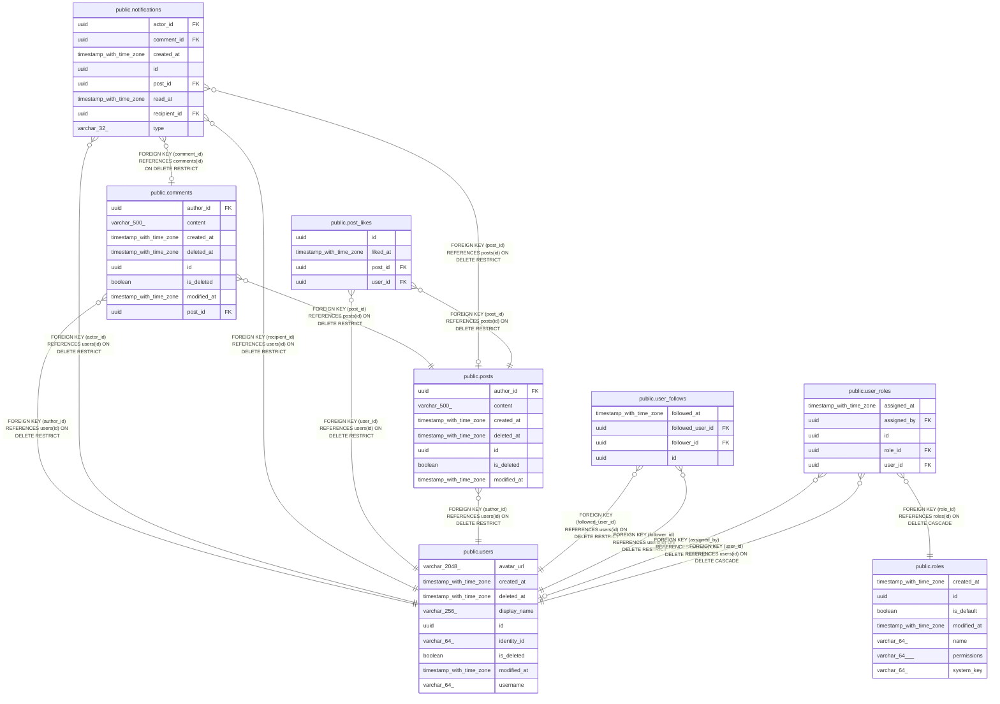

# choco

## Tables

| Name                                            | Columns | Comment                                                                                                      | Type       |
| ----------------------------------------------- | ------- | ------------------------------------------------------------------------------------------------------------ | ---------- |
| [public.comments](public.comments.md)           | 8       | Comments that users write on posts.                                                                          | BASE TABLE |
| [public.notifications](public.notifications.md) | 8       | Things that happened to a user, such as a new follower, shown to that user.                                  | BASE TABLE |
| [public.post_likes](public.post_likes.md)       | 4       | Active likes that users give to posts.                                                                       | BASE TABLE |
| [public.posts](public.posts.md)                 | 7       | Text posts that users publish.                                                                               | BASE TABLE |
| [public.roles](public.roles.md)                 | 7       | Named sets of permissions that users can hold. Roles and their permissions can change while the system runs. | BASE TABLE |
| [public.user_follows](public.user_follows.md)   | 4       | Active follow relationships between users.                                                                   | BASE TABLE |
| [public.user_roles](public.user_roles.md)       | 5       | Roles assigned to users, besides the default role that every signed-in user has.                             | BASE TABLE |
| [public.users](public.users.md)                 | 9       | People who use choco-api. Sign-in lives in Clerk; each row is the local copy of one Clerk user.              | BASE TABLE |

## Stored procedures and functions

| Name                   | ReturnType | Arguments                              | Type     |
| ---------------------- | ---------- | -------------------------------------- | -------- |
| public.unaccent        | text       | regdictionary, text                    | FUNCTION |
| public.unaccent        | text       | text                                   | FUNCTION |
| public.unaccent_init   | internal   | internal                               | FUNCTION |
| public.unaccent_lexize | internal   | internal, internal, internal, internal | FUNCTION |

## Relations

---

> Generated by [tbls](https://github.com/k1LoW/tbls)
