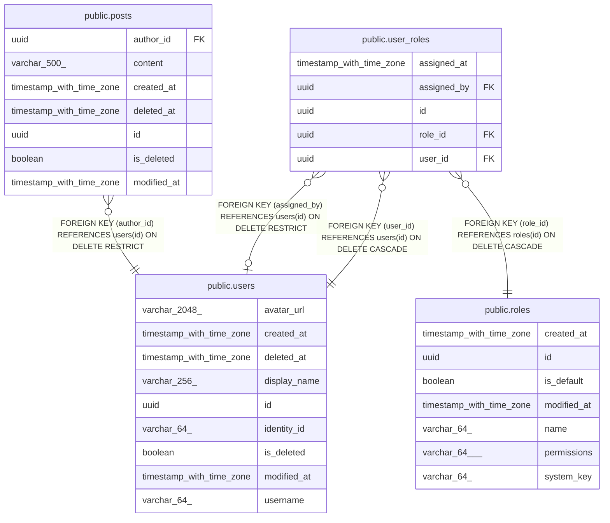

# choco

## Tables

| Name                                      | Columns | Comment                                                                                                      | Type       |
| ----------------------------------------- | ------- | ------------------------------------------------------------------------------------------------------------ | ---------- |
| [public.posts](public.posts.md)           | 7       | Text posts that users publish.                                                                               | BASE TABLE |
| [public.roles](public.roles.md)           | 7       | Named sets of permissions that users can hold. Roles and their permissions can change while the system runs. | BASE TABLE |
| [public.user_roles](public.user_roles.md) | 5       | Roles assigned to users, besides the default role that every signed-in user has.                             | BASE TABLE |
| [public.users](public.users.md)           | 9       | People who use choco-api. Sign-in lives in Clerk; each row is the local copy of one Clerk user.              | BASE TABLE |

## Stored procedures and functions

| Name                   | ReturnType | Arguments                              | Type     |
| ---------------------- | ---------- | -------------------------------------- | -------- |
| public.unaccent        | text       | regdictionary, text                    | FUNCTION |
| public.unaccent        | text       | text                                   | FUNCTION |
| public.unaccent_init   | internal   | internal                               | FUNCTION |
| public.unaccent_lexize | internal   | internal, internal, internal, internal | FUNCTION |

## Relations

---

> Generated by [tbls](https://github.com/k1LoW/tbls)
