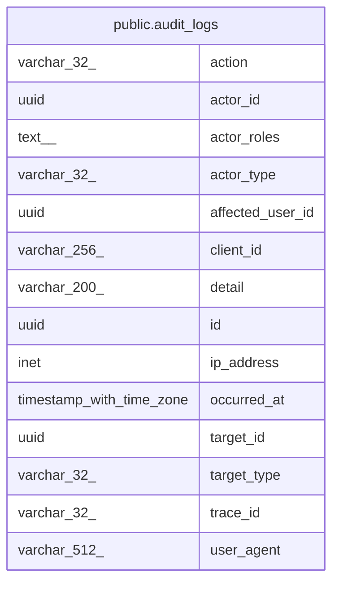

# public.audit_logs

## Description

Append-only record of who did what to which object. One row per successful action of a user or the system; rows are never changed.

## Columns

| Name             | Type                     | Default | Nullable | Children | Parents | Comment                                                                                                            |
| ---------------- | ------------------------ | ------- | -------- | -------- | ------- | ------------------------------------------------------------------------------------------------------------------ |
| action           | varchar(32)              |         | false    |          |         | What was done, for example PostDeleted or RoleAssigned.                                                            |
| actor_id         | uuid                     |         | true     |          |         | User who performed the action; null when the actor is the system. Kept after the user deletes their account.       |
| actor_roles      | text[]                   |         | false    |          |         | Names of the roles the actor held when the action happened.                                                        |
| actor_type       | varchar(32)              |         | false    |          |         | Who performed the action: User, or System for work no user triggered.                                              |
| affected_user_id | uuid                     |         | true     |          |         | User whose data or account the action changed, when it is not the actor, for example the author of a removed post. |
| client_id        | varchar(256)             |         | true     |          |         | Client application that sent the request, taken from the authorized party of the access token.                     |
| detail           | varchar(200)             |         | true     |          |         | Short note that qualifies the action, such as a role name or a new status. Never holds post or comment content.    |
| id               | uuid                     |         | false    |          |         | Primary key, generated by the API.                                                                                 |
| ip_address       | inet                     |         | true     |          |         | Address of the client that sent the request, taken from the forwarded headers of the trusted proxy.                |
| occurred_at      | timestamp with time zone |         | false    |          |         | When the action happened, taken from the API clock.                                                                |
| target_id        | uuid                     |         | false    |          |         | Id of the object the action was done to; the table it points to depends on target_type.                            |
| target_type      | varchar(32)              |         | false    |          |         | Kind of object the action was done to: Post, Comment, User, Report, Feedback or Role.                              |
| trace_id         | varchar(32)              |         | true     |          |         | Trace id of the request that caused the action, to find its application log lines.                                 |
| user_agent       | varchar(512)             |         | true     |          |         | User agent the client sent with the request, cut to the column length.                                             |

## Constraints

| Name                            | Type        | Definition           |
| ------------------------------- | ----------- | -------------------- |
| audit_logs_action_not_null      | n           | NOT NULL action      |
| audit_logs_actor_roles_not_null | n           | NOT NULL actor_roles |
| audit_logs_actor_type_not_null  | n           | NOT NULL actor_type  |
| audit_logs_id_not_null          | n           | NOT NULL id          |
| audit_logs_occurred_at_not_null | n           | NOT NULL occurred_at |
| audit_logs_target_id_not_null   | n           | NOT NULL target_id   |
| audit_logs_target_type_not_null | n           | NOT NULL target_type |
| pk_audit_logs                   | PRIMARY KEY | PRIMARY KEY (id)     |

## Indexes

| Name                                            | Definition                                                                                                                          |
| ----------------------------------------------- | ----------------------------------------------------------------------------------------------------------------------------------- |
| ix_audit_logs_actor_id_occurred_at              | CREATE INDEX ix_audit_logs_actor_id_occurred_at ON public.audit_logs USING btree (actor_id, occurred_at)                            |
| ix_audit_logs_affected_user_id_occurred_at      | CREATE INDEX ix_audit_logs_affected_user_id_occurred_at ON public.audit_logs USING btree (affected_user_id, occurred_at)            |
| ix_audit_logs_occurred_at_id                    | CREATE INDEX ix_audit_logs_occurred_at_id ON public.audit_logs USING btree (occurred_at DESC, id DESC)                              |
| ix_audit_logs_target_type_target_id_occurred_at | CREATE INDEX ix_audit_logs_target_type_target_id_occurred_at ON public.audit_logs USING btree (target_type, target_id, occurred_at) |
| pk_audit_logs                                   | CREATE UNIQUE INDEX pk_audit_logs ON public.audit_logs USING btree (id)                                                             |

## Relations

---

> Generated by [tbls](https://github.com/k1LoW/tbls)
