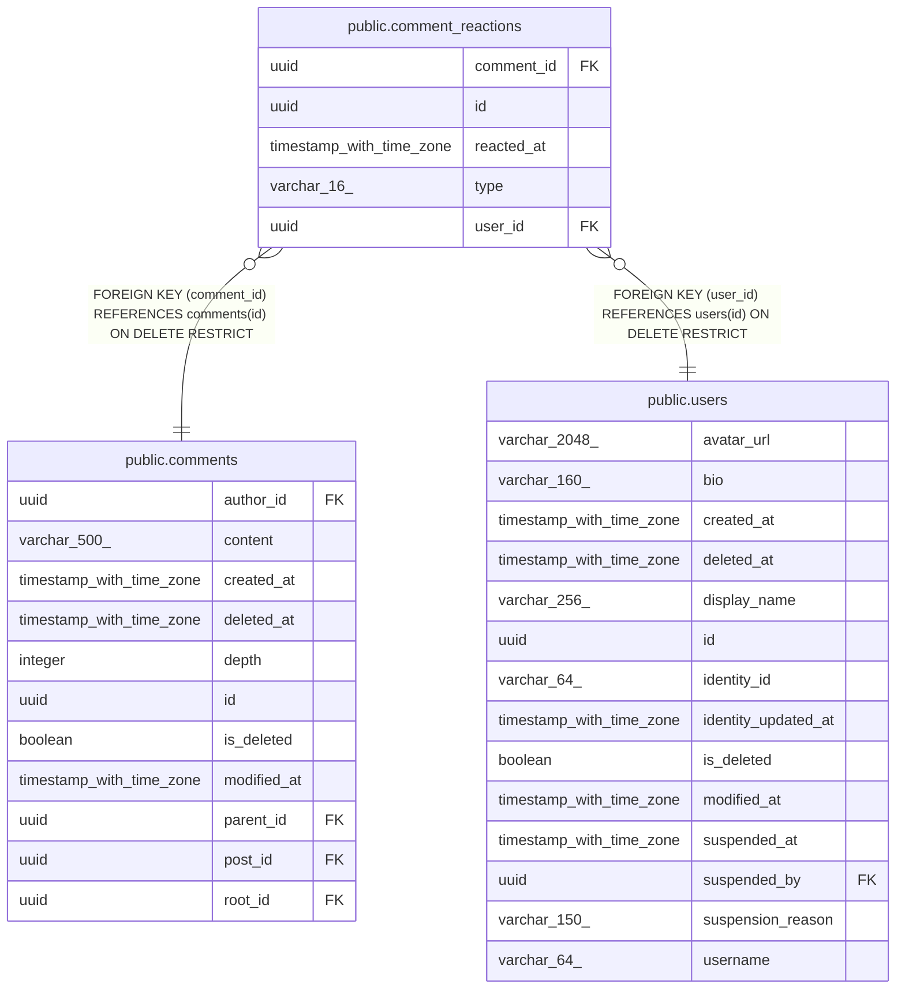

# public.comment_reactions

## Description

Likes and dislikes that users give to comments, at most one per user and comment.

## Columns

| Name       | Type                     | Default | Nullable | Children | Parents                               | Comment                                  |
| ---------- | ------------------------ | ------- | -------- | -------- | ------------------------------------- | ---------------------------------------- |
| comment_id | uuid                     |         | false    |          | [public.comments](public.comments.md) | Comment that was reacted to.             |
| id         | uuid                     |         | false    |          |                                       | Primary key, generated by the API.       |
| reacted_at | timestamp with time zone |         | false    |          |                                       | When the user gave the current reaction. |
| type       | varchar(16)              |         | false    |          |                                       | The reaction: Like or Dislike.           |
| user_id    | uuid                     |         | false    |          | [public.users](public.users.md)       | User who reacted to the comment.         |

## Constraints

| Name                                     | Type        | Definition                                                          |
| ---------------------------------------- | ----------- | ------------------------------------------------------------------- |
| comment_reactions_comment_id_not_null    | n           | NOT NULL comment_id                                                 |
| comment_reactions_id_not_null            | n           | NOT NULL id                                                         |
| comment_reactions_reacted_at_not_null    | n           | NOT NULL reacted_at                                                 |
| comment_reactions_type_not_null          | n           | NOT NULL type                                                       |
| comment_reactions_user_id_not_null       | n           | NOT NULL user_id                                                    |
| fk_comment_reactions_comments_comment_id | FOREIGN KEY | FOREIGN KEY (comment_id) REFERENCES comments(id) ON DELETE RESTRICT |
| fk_comment_reactions_user_user_id        | FOREIGN KEY | FOREIGN KEY (user_id) REFERENCES users(id) ON DELETE RESTRICT       |
| pk_comment_reactions                     | PRIMARY KEY | PRIMARY KEY (id)                                                    |

## Indexes

| Name                                    | Definition                                                                                                                |
| --------------------------------------- | ------------------------------------------------------------------------------------------------------------------------- |
| ix_comment_reactions_comment_id_user_id | CREATE UNIQUE INDEX ix_comment_reactions_comment_id_user_id ON public.comment_reactions USING btree (comment_id, user_id) |
| ix_comment_reactions_user_id            | CREATE INDEX ix_comment_reactions_user_id ON public.comment_reactions USING btree (user_id)                               |
| pk_comment_reactions                    | CREATE UNIQUE INDEX pk_comment_reactions ON public.comment_reactions USING btree (id)                                     |

## Relations

---

> Generated by [tbls](https://github.com/k1LoW/tbls)
