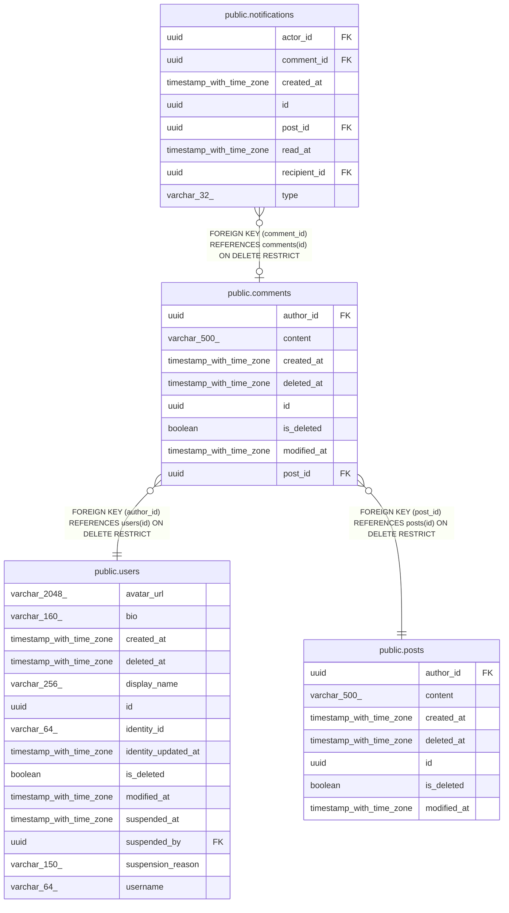

# public.comments

## Description

Comments that users write on posts.

## Columns

| Name        | Type                     | Default | Nullable | Children                                        | Parents                         | Comment                                                                             |
| ----------- | ------------------------ | ------- | -------- | ----------------------------------------------- | ------------------------------- | ----------------------------------------------------------------------------------- |
| author_id   | uuid                     |         | false    |                                                 | [public.users](public.users.md) | User who wrote the comment.                                                         |
| content     | varchar(500)             |         | false    |                                                 |                                 | Comment text as the author wrote it.                                                |
| created_at  | timestamp with time zone |         | false    |                                                 |                                 | When the row was created.                                                           |
| deleted_at  | timestamp with time zone |         | true     |                                                 |                                 | When the row was soft-deleted; null while it is not.                                |
| id          | uuid                     |         | false    | [public.notifications](public.notifications.md) |                                 | Primary key, generated by the API.                                                  |
| is_deleted  | boolean                  |         | false    |                                                 |                                 | True when the row is soft-deleted. Queries skip such rows unless they ask for them. |
| modified_at | timestamp with time zone |         | false    |                                                 |                                 | When the row was last changed.                                                      |
| post_id     | uuid                     |         | false    |                                                 | [public.posts](public.posts.md) | Post the comment belongs to.                                                        |

## Constraints

| Name                          | Type        | Definition                                                      |
| ----------------------------- | ----------- | --------------------------------------------------------------- |
| comments_author_id_not_null   | n           | NOT NULL author_id                                              |
| comments_content_not_null     | n           | NOT NULL content                                                |
| comments_created_at_not_null  | n           | NOT NULL created_at                                             |
| comments_id_not_null          | n           | NOT NULL id                                                     |
| comments_is_deleted_not_null  | n           | NOT NULL is_deleted                                             |
| comments_modified_at_not_null | n           | NOT NULL modified_at                                            |
| comments_post_id_not_null     | n           | NOT NULL post_id                                                |
| fk_comments_post_post_id      | FOREIGN KEY | FOREIGN KEY (post_id) REFERENCES posts(id) ON DELETE RESTRICT   |
| fk_comments_user_author_id    | FOREIGN KEY | FOREIGN KEY (author_id) REFERENCES users(id) ON DELETE RESTRICT |
| pk_comments                   | PRIMARY KEY | PRIMARY KEY (id)                                                |

## Indexes

| Name                              | Definition                                                                                              |
| --------------------------------- | ------------------------------------------------------------------------------------------------------- |
| ix_comments_author_id             | CREATE INDEX ix_comments_author_id ON public.comments USING btree (author_id)                           |
| ix_comments_post_id_created_at_id | CREATE INDEX ix_comments_post_id_created_at_id ON public.comments USING btree (post_id, created_at, id) |
| pk_comments                       | CREATE UNIQUE INDEX pk_comments ON public.comments USING btree (id)                                     |

## Relations

---

> Generated by [tbls](https://github.com/k1LoW/tbls)
