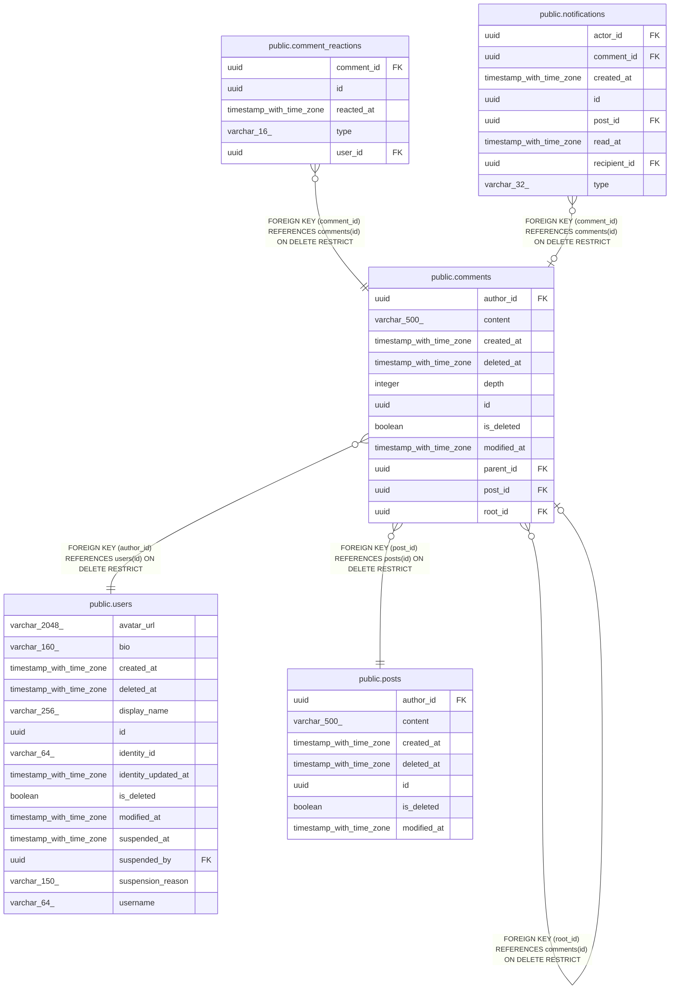

# public.comments

## Description

Comments that users write on posts.

## Columns

| Name        | Type                     | Default | Nullable | Children                                                                                                                                      | Parents                               | Comment                                                                                          |
| ----------- | ------------------------ | ------- | -------- | --------------------------------------------------------------------------------------------------------------------------------------------- | ------------------------------------- | ------------------------------------------------------------------------------------------------ |
| author_id   | uuid                     |         | false    |                                                                                                                                               | [public.users](public.users.md)       | User who wrote the comment.                                                                      |
| content     | varchar(500)             |         | false    |                                                                                                                                               |                                       | Comment text as the author wrote it.                                                             |
| created_at  | timestamp with time zone |         | false    |                                                                                                                                               |                                       | When the row was created.                                                                        |
| deleted_at  | timestamp with time zone |         | true     |                                                                                                                                               |                                       | When the row was soft-deleted; null while it is not.                                             |
| depth       | integer                  | 0       | false    |                                                                                                                                               |                                       | How many replies deep the comment is: 0 for a top-level comment, 1 for a reply to it, and so on. |
| id          | uuid                     |         | false    | [public.comment_reactions](public.comment_reactions.md) [public.comments](public.comments.md) [public.notifications](public.notifications.md) |                                       | Primary key, generated by the API.                                                               |
| is_deleted  | boolean                  |         | false    |                                                                                                                                               |                                       | True when the row is soft-deleted. Queries skip such rows unless they ask for them.              |
| modified_at | timestamp with time zone |         | false    |                                                                                                                                               |                                       | When the row was last changed.                                                                   |
| parent_id   | uuid                     |         | true     |                                                                                                                                               | [public.comments](public.comments.md) | Comment this one replies to; null for a comment written on the post itself.                      |
| post_id     | uuid                     |         | false    |                                                                                                                                               | [public.posts](public.posts.md)       | Post the comment belongs to.                                                                     |
| root_id     | uuid                     |         | true     |                                                                                                                                               | [public.comments](public.comments.md) | Top-level comment of the thread this reply belongs to; null for a top-level comment.             |

## Constraints

| Name                           | Type        | Definition                                                         |
| ------------------------------ | ----------- | ------------------------------------------------------------------ |
| comments_author_id_not_null    | n           | NOT NULL author_id                                                 |
| comments_content_not_null      | n           | NOT NULL content                                                   |
| comments_created_at_not_null   | n           | NOT NULL created_at                                                |
| comments_depth_not_null        | n           | NOT NULL depth                                                     |
| comments_id_not_null           | n           | NOT NULL id                                                        |
| comments_is_deleted_not_null   | n           | NOT NULL is_deleted                                                |
| comments_modified_at_not_null  | n           | NOT NULL modified_at                                               |
| comments_post_id_not_null      | n           | NOT NULL post_id                                                   |
| fk_comments_comments_parent_id | FOREIGN KEY | FOREIGN KEY (parent_id) REFERENCES comments(id) ON DELETE RESTRICT |
| fk_comments_comments_root_id   | FOREIGN KEY | FOREIGN KEY (root_id) REFERENCES comments(id) ON DELETE RESTRICT   |
| fk_comments_post_post_id       | FOREIGN KEY | FOREIGN KEY (post_id) REFERENCES posts(id) ON DELETE RESTRICT      |
| fk_comments_user_author_id     | FOREIGN KEY | FOREIGN KEY (author_id) REFERENCES users(id) ON DELETE RESTRICT    |
| pk_comments                    | PRIMARY KEY | PRIMARY KEY (id)                                                   |

## Indexes

| Name                                | Definition                                                                                                  |
| ----------------------------------- | ----------------------------------------------------------------------------------------------------------- |
| ix_comments_author_id               | CREATE INDEX ix_comments_author_id ON public.comments USING btree (author_id)                               |
| ix_comments_parent_id_created_at_id | CREATE INDEX ix_comments_parent_id_created_at_id ON public.comments USING btree (parent_id, created_at, id) |
| ix_comments_post_id_created_at_id   | CREATE INDEX ix_comments_post_id_created_at_id ON public.comments USING btree (post_id, created_at, id)     |
| ix_comments_root_id                 | CREATE INDEX ix_comments_root_id ON public.comments USING btree (root_id)                                   |
| pk_comments                         | CREATE UNIQUE INDEX pk_comments ON public.comments USING btree (id)                                         |

## Relations

---

> Generated by [tbls](https://github.com/k1LoW/tbls)
