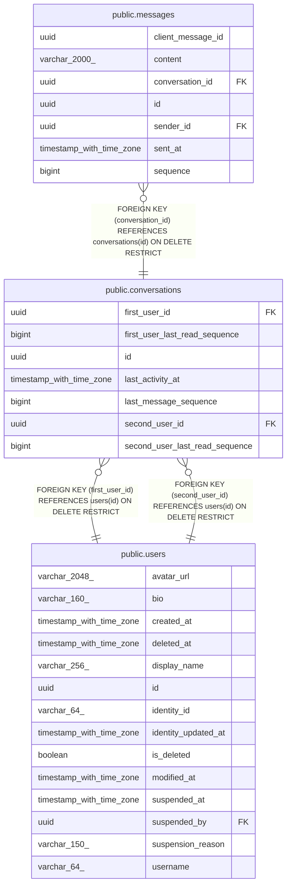

# public.conversations

## Description

Direct conversations between two users.

## Columns

| Name                           | Type                     | Default | Nullable | Children                              | Parents                         | Comment                                                                                            |
| ------------------------------ | ------------------------ | ------- | -------- | ------------------------------------- | ------------------------------- | -------------------------------------------------------------------------------------------------- |
| first_user_id                  | uuid                     |         | false    |                                       | [public.users](public.users.md) | One of the two users; the pair is stored in a fixed order so that two users have one conversation. |
| first_user_last_read_sequence  | bigint                   |         | false    |                                       |                                 | Sequence number of the last message the first user has read; 0 when none.                          |
| id                             | uuid                     |         | false    | [public.messages](public.messages.md) |                                 | Primary key, generated by the API.                                                                 |
| last_activity_at               | timestamp with time zone |         | false    |                                       |                                 | When the newest message was sent, or when the conversation was created if it has none.             |
| last_message_sequence          | bigint                   |         | false    |                                       |                                 | Sequence number of the newest message; 0 when there is none.                                       |
| second_user_id                 | uuid                     |         | false    |                                       | [public.users](public.users.md) | The other of the two users.                                                                        |
| second_user_last_read_sequence | bigint                   |         | false    |                                       |                                 | Sequence number of the last message the second user has read; 0 when none.                         |

## Constraints

| Name                                                  | Type        | Definition                                                           |
| ----------------------------------------------------- | ----------- | -------------------------------------------------------------------- |
| conversations_first_user_id_not_null                  | n           | NOT NULL first_user_id                                               |
| conversations_first_user_last_read_sequence_not_null  | n           | NOT NULL first_user_last_read_sequence                               |
| conversations_id_not_null                             | n           | NOT NULL id                                                          |
| conversations_last_activity_at_not_null               | n           | NOT NULL last_activity_at                                            |
| conversations_last_message_sequence_not_null          | n           | NOT NULL last_message_sequence                                       |
| conversations_second_user_id_not_null                 | n           | NOT NULL second_user_id                                              |
| conversations_second_user_last_read_sequence_not_null | n           | NOT NULL second_user_last_read_sequence                              |
| fk_conversations_user_first_user_id                   | FOREIGN KEY | FOREIGN KEY (first_user_id) REFERENCES users(id) ON DELETE RESTRICT  |
| fk_conversations_user_second_user_id                  | FOREIGN KEY | FOREIGN KEY (second_user_id) REFERENCES users(id) ON DELETE RESTRICT |
| pk_conversations                                      | PRIMARY KEY | PRIMARY KEY (id)                                                     |

## Indexes

| Name                                          | Definition                                                                                                                            |
| --------------------------------------------- | ------------------------------------------------------------------------------------------------------------------------------------- |
| ix_conversations_first_user_id_second_user_id | CREATE UNIQUE INDEX ix_conversations_first_user_id_second_user_id ON public.conversations USING btree (first_user_id, second_user_id) |
| ix_conversations_second_user_id               | CREATE INDEX ix_conversations_second_user_id ON public.conversations USING btree (second_user_id)                                     |
| pk_conversations                              | CREATE UNIQUE INDEX pk_conversations ON public.conversations USING btree (id)                                                         |

## Relations

---

> Generated by [tbls](https://github.com/k1LoW/tbls)
