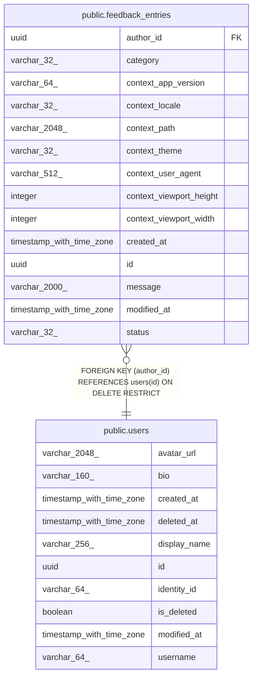

# public.feedback_entries

## Description

Bug reports and suggestions about the app that signed-in users send, waiting for or finished with an administrator's triage.

## Columns

| Name                    | Type                     | Default | Nullable | Children | Parents                         | Comment                                                             |
| ----------------------- | ------------------------ | ------- | -------- | -------- | ------------------------------- | ------------------------------------------------------------------- |
| author_id               | uuid                     |         | false    |          | [public.users](public.users.md) | User who sent the feedback.                                         |
| category                | varchar(32)              |         | false    |          |                                 | What kind of feedback it is: Bug, Suggestion or Other.              |
| context_app_version     | varchar(64)              |         | false    |          |                                 | Build commit SHA of the web app.                                    |
| context_locale          | varchar(32)              |         | false    |          |                                 | Language of the app when the feedback was sent: En, Ja or Vi.       |
| context_path            | varchar(2048)            |         | false    |          |                                 | Pathname of the page the user was on, without query string or hash. |
| context_theme           | varchar(32)              |         | false    |          |                                 | Theme of the app when the feedback was sent: Light, Dark or System. |
| context_user_agent      | varchar(512)             |         | false    |          |                                 | Browser user agent reported by the web app.                         |
| context_viewport_height | integer                  |         | false    |          |                                 | Height of the browser viewport in pixels.                           |
| context_viewport_width  | integer                  |         | false    |          |                                 | Width of the browser viewport in pixels.                            |
| created_at              | timestamp with time zone |         | false    |          |                                 | When the row was created.                                           |
| id                      | uuid                     |         | false    |          |                                 | Primary key, generated by the API.                                  |
| message                 | varchar(2000)            |         | false    |          |                                 | What the user wrote, trimmed.                                       |
| modified_at             | timestamp with time zone |         | false    |          |                                 | When the row was last changed.                                      |
| status                  | varchar(32)              |         | false    |          |                                 | Triage state: New, InProgress, Resolved or WontFix.                 |

## Constraints

| Name                                              | Type        | Definition                                                      |
| ------------------------------------------------- | ----------- | --------------------------------------------------------------- |
| feedback_entries_author_id_not_null               | n           | NOT NULL author_id                                              |
| feedback_entries_category_not_null                | n           | NOT NULL category                                               |
| feedback_entries_context_app_version_not_null     | n           | NOT NULL context_app_version                                    |
| feedback_entries_context_locale_not_null          | n           | NOT NULL context_locale                                         |
| feedback_entries_context_path_not_null            | n           | NOT NULL context_path                                           |
| feedback_entries_context_theme_not_null           | n           | NOT NULL context_theme                                          |
| feedback_entries_context_user_agent_not_null      | n           | NOT NULL context_user_agent                                     |
| feedback_entries_context_viewport_height_not_null | n           | NOT NULL context_viewport_height                                |
| feedback_entries_context_viewport_width_not_null  | n           | NOT NULL context_viewport_width                                 |
| feedback_entries_created_at_not_null              | n           | NOT NULL created_at                                             |
| feedback_entries_id_not_null                      | n           | NOT NULL id                                                     |
| feedback_entries_message_not_null                 | n           | NOT NULL message                                                |
| feedback_entries_modified_at_not_null             | n           | NOT NULL modified_at                                            |
| feedback_entries_status_not_null                  | n           | NOT NULL status                                                 |
| fk_feedback_entries_user_author_id                | FOREIGN KEY | FOREIGN KEY (author_id) REFERENCES users(id) ON DELETE RESTRICT |
| pk_feedback_entries                               | PRIMARY KEY | PRIMARY KEY (id)                                                |

## Indexes

| Name                              | Definition                                                                                                       |
| --------------------------------- | ---------------------------------------------------------------------------------------------------------------- |
| ix_feedback_entries_author_id     | CREATE INDEX ix_feedback_entries_author_id ON public.feedback_entries USING btree (author_id)                    |
| ix_feedback_entries_created_at_id | CREATE INDEX ix_feedback_entries_created_at_id ON public.feedback_entries USING btree (created_at DESC, id DESC) |
| pk_feedback_entries               | CREATE UNIQUE INDEX pk_feedback_entries ON public.feedback_entries USING btree (id)                              |

## Relations

---

> Generated by [tbls](https://github.com/k1LoW/tbls)
