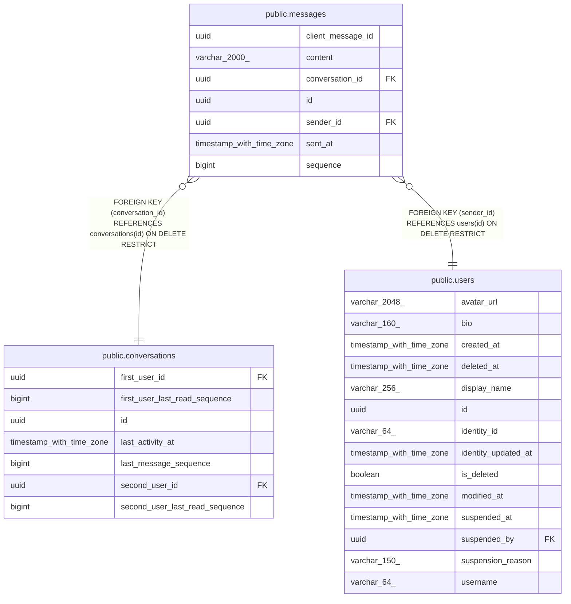

# public.messages

## Description

Text messages that users send in direct conversations.

## Columns

| Name              | Type                     | Default | Nullable | Children | Parents                                         | Comment                                                                                                |
| ----------------- | ------------------------ | ------- | -------- | -------- | ----------------------------------------------- | ------------------------------------------------------------------------------------------------------ |
| client_message_id | uuid                     |         | false    |          |                                                 | Identifier the sender's client created for the send; a repeated send with it returns the same message. |
| content           | varchar(2000)            |         | false    |          |                                                 | Message text as the sender wrote it, without leading and trailing whitespace.                          |
| conversation_id   | uuid                     |         | false    |          | [public.conversations](public.conversations.md) | Conversation the message belongs to.                                                                   |
| id                | uuid                     |         | false    |          |                                                 | Primary key, generated by the API.                                                                     |
| sender_id         | uuid                     |         | false    |          | [public.users](public.users.md)                 | User who sent the message.                                                                             |
| sent_at           | timestamp with time zone |         | false    |          |                                                 | When the message was saved.                                                                            |
| sequence          | bigint                   |         | false    |          |                                                 | Position of the message in its conversation, starting at 1 and growing by one per message.             |

## Constraints

| Name                                      | Type        | Definition                                                                    |
| ----------------------------------------- | ----------- | ----------------------------------------------------------------------------- |
| fk_messages_conversations_conversation_id | FOREIGN KEY | FOREIGN KEY (conversation_id) REFERENCES conversations(id) ON DELETE RESTRICT |
| fk_messages_user_sender_id                | FOREIGN KEY | FOREIGN KEY (sender_id) REFERENCES users(id) ON DELETE RESTRICT               |
| messages_client_message_id_not_null       | n           | NOT NULL client_message_id                                                    |
| messages_content_not_null                 | n           | NOT NULL content                                                              |
| messages_conversation_id_not_null         | n           | NOT NULL conversation_id                                                      |
| messages_id_not_null                      | n           | NOT NULL id                                                                   |
| messages_sender_id_not_null               | n           | NOT NULL sender_id                                                            |
| messages_sent_at_not_null                 | n           | NOT NULL sent_at                                                              |
| messages_sequence_not_null                | n           | NOT NULL sequence                                                             |
| pk_messages                               | PRIMARY KEY | PRIMARY KEY (id)                                                              |

## Indexes

| Name                                                    | Definition                                                                                                                                                 |
| ------------------------------------------------------- | ---------------------------------------------------------------------------------------------------------------------------------------------------------- |
| ix_messages_conversation_id_sender_id_client_message_id | CREATE UNIQUE INDEX ix_messages_conversation_id_sender_id_client_message_id ON public.messages USING btree (conversation_id, sender_id, client_message_id) |
| ix_messages_conversation_id_sequence                    | CREATE UNIQUE INDEX ix_messages_conversation_id_sequence ON public.messages USING btree (conversation_id, sequence)                                        |
| ix_messages_sender_id                                   | CREATE INDEX ix_messages_sender_id ON public.messages USING btree (sender_id)                                                                              |
| pk_messages                                             | CREATE UNIQUE INDEX pk_messages ON public.messages USING btree (id)                                                                                        |

## Relations

---

> Generated by [tbls](https://github.com/k1LoW/tbls)
