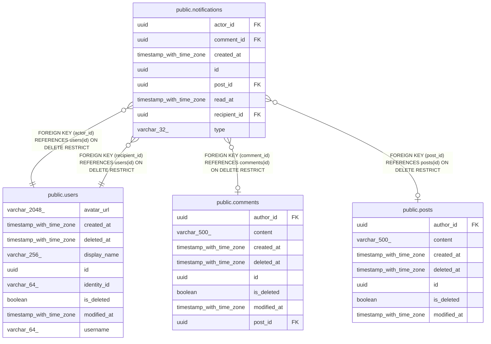

# public.notifications

## Description

Things that happened to a user, such as a new follower, shown to that user.

## Columns

| Name         | Type                     | Default | Nullable | Children | Parents                               | Comment                                                                 |
| ------------ | ------------------------ | ------- | -------- | -------- | ------------------------------------- | ----------------------------------------------------------------------- |
| actor_id     | uuid                     |         | false    |          | [public.users](public.users.md)       | User whose action caused the notification.                              |
| comment_id   | uuid                     |         | true     |          | [public.comments](public.comments.md) | Comment the notification is about; null when it is not about a comment. |
| created_at   | timestamp with time zone |         | false    |          |                                       | When it happened.                                                       |
| id           | uuid                     |         | false    |          |                                       | Primary key, generated by the API.                                      |
| post_id      | uuid                     |         | true     |          | [public.posts](public.posts.md)       | Post the notification is about; null when it is not about a post.       |
| read_at      | timestamp with time zone |         | true     |          |                                       | When the recipient marked it read; null while unread.                   |
| recipient_id | uuid                     |         | false    |          | [public.users](public.users.md)       | User who is notified.                                                   |
| type         | varchar(32)              |         | false    |          |                                       | What happened, such as Followed, PostLiked or PostCommented.            |

## Constraints

| Name                                 | Type        | Definition                                                          |
| ------------------------------------ | ----------- | ------------------------------------------------------------------- |
| fk_notifications_comments_comment_id | FOREIGN KEY | FOREIGN KEY (comment_id) REFERENCES comments(id) ON DELETE RESTRICT |
| fk_notifications_post_post_id        | FOREIGN KEY | FOREIGN KEY (post_id) REFERENCES posts(id) ON DELETE RESTRICT       |
| fk_notifications_user_actor_id       | FOREIGN KEY | FOREIGN KEY (actor_id) REFERENCES users(id) ON DELETE RESTRICT      |
| fk_notifications_user_recipient_id   | FOREIGN KEY | FOREIGN KEY (recipient_id) REFERENCES users(id) ON DELETE RESTRICT  |
| notifications_actor_id_not_null      | n           | NOT NULL actor_id                                                   |
| notifications_created_at_not_null    | n           | NOT NULL created_at                                                 |
| notifications_id_not_null            | n           | NOT NULL id                                                         |
| notifications_recipient_id_not_null  | n           | NOT NULL recipient_id                                               |
| notifications_type_not_null          | n           | NOT NULL type                                                       |
| pk_notifications                     | PRIMARY KEY | PRIMARY KEY (id)                                                    |

## Indexes

| Name                                        | Definition                                                                                                                            |
| ------------------------------------------- | ------------------------------------------------------------------------------------------------------------------------------------- |
| ix_notifications_actor_id                   | CREATE INDEX ix_notifications_actor_id ON public.notifications USING btree (actor_id)                                                 |
| ix_notifications_comment_id                 | CREATE INDEX ix_notifications_comment_id ON public.notifications USING btree (comment_id)                                             |
| ix_notifications_post_id                    | CREATE INDEX ix_notifications_post_id ON public.notifications USING btree (post_id)                                                   |
| ix_notifications_recipient_id_created_at_id | CREATE INDEX ix_notifications_recipient_id_created_at_id ON public.notifications USING btree (recipient_id, created_at DESC, id DESC) |
| ix_notifications_recipient_id_unread        | CREATE INDEX ix_notifications_recipient_id_unread ON public.notifications USING btree (recipient_id) WHERE (read_at IS NULL)          |
| pk_notifications                            | CREATE UNIQUE INDEX pk_notifications ON public.notifications USING btree (id)                                                         |

## Relations

---

> Generated by [tbls](https://github.com/k1LoW/tbls)
