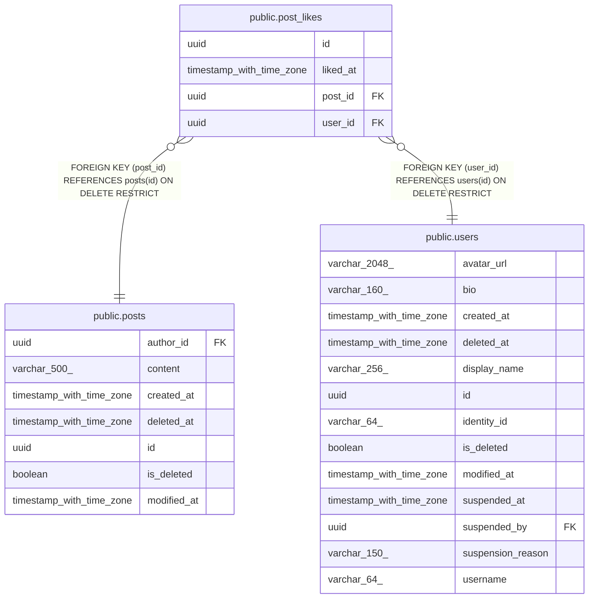

# public.post_likes

## Description

Active likes that users give to posts.

## Columns

| Name     | Type                     | Default | Nullable | Children | Parents                         | Comment                            |
| -------- | ------------------------ | ------- | -------- | -------- | ------------------------------- | ---------------------------------- |
| id       | uuid                     |         | false    |          |                                 | Primary key, generated by the API. |
| liked_at | timestamp with time zone |         | false    |          |                                 | When the user liked the post.      |
| post_id  | uuid                     |         | false    |          | [public.posts](public.posts.md) | Post that was liked.               |
| user_id  | uuid                     |         | false    |          | [public.users](public.users.md) | User who liked the post.           |

## Constraints

| Name                         | Type        | Definition                                                    |
| ---------------------------- | ----------- | ------------------------------------------------------------- |
| fk_post_likes_posts_post_id  | FOREIGN KEY | FOREIGN KEY (post_id) REFERENCES posts(id) ON DELETE RESTRICT |
| fk_post_likes_user_user_id   | FOREIGN KEY | FOREIGN KEY (user_id) REFERENCES users(id) ON DELETE RESTRICT |
| pk_post_likes                | PRIMARY KEY | PRIMARY KEY (id)                                              |
| post_likes_id_not_null       | n           | NOT NULL id                                                   |
| post_likes_liked_at_not_null | n           | NOT NULL liked_at                                             |
| post_likes_post_id_not_null  | n           | NOT NULL post_id                                              |
| post_likes_user_id_not_null  | n           | NOT NULL user_id                                              |

## Indexes

| Name                          | Definition                                                                                            |
| ----------------------------- | ----------------------------------------------------------------------------------------------------- |
| ix_post_likes_post_id_user_id | CREATE UNIQUE INDEX ix_post_likes_post_id_user_id ON public.post_likes USING btree (post_id, user_id) |
| ix_post_likes_user_id         | CREATE INDEX ix_post_likes_user_id ON public.post_likes USING btree (user_id)                         |
| pk_post_likes                 | CREATE UNIQUE INDEX pk_post_likes ON public.post_likes USING btree (id)                               |

## Relations

---

> Generated by [tbls](https://github.com/k1LoW/tbls)
