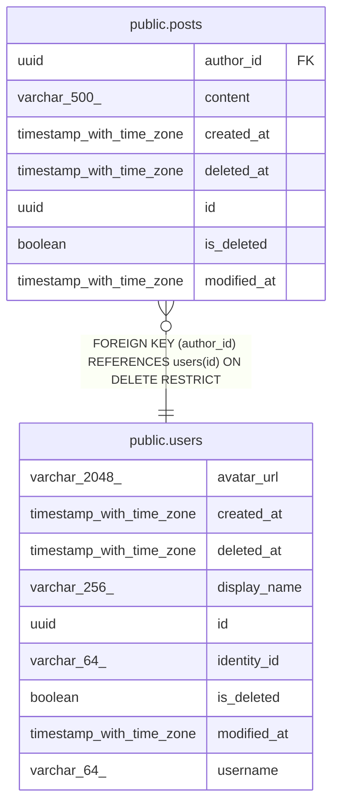

# public.posts

## Description

Text posts that users publish.

## Columns

| Name        | Type                     | Default | Nullable | Children | Parents                         | Comment                                                                             |
| ----------- | ------------------------ | ------- | -------- | -------- | ------------------------------- | ----------------------------------------------------------------------------------- |
| author_id   | uuid                     |         | false    |          | [public.users](public.users.md) | User who wrote the post.                                                            |
| content     | varchar(500)             |         | false    |          |                                 | Post text as the author wrote it.                                                   |
| created_at  | timestamp with time zone |         | false    |          |                                 | When the row was created.                                                           |
| deleted_at  | timestamp with time zone |         | true     |          |                                 | When the row was soft-deleted; null while it is not.                                |
| id          | uuid                     |         | false    |          |                                 | Primary key, generated by the API.                                                  |
| is_deleted  | boolean                  |         | false    |          |                                 | True when the row is soft-deleted. Queries skip such rows unless they ask for them. |
| modified_at | timestamp with time zone |         | false    |          |                                 | When the row was last changed.                                                      |

## Constraints

| Name                       | Type        | Definition                                                      |
| -------------------------- | ----------- | --------------------------------------------------------------- |
| fk_posts_user_author_id    | FOREIGN KEY | FOREIGN KEY (author_id) REFERENCES users(id) ON DELETE RESTRICT |
| pk_posts                   | PRIMARY KEY | PRIMARY KEY (id)                                                |
| posts_author_id_not_null   | n           | NOT NULL author_id                                              |
| posts_content_not_null     | n           | NOT NULL content                                                |
| posts_created_at_not_null  | n           | NOT NULL created_at                                             |
| posts_id_not_null          | n           | NOT NULL id                                                     |
| posts_is_deleted_not_null  | n           | NOT NULL is_deleted                                             |
| posts_modified_at_not_null | n           | NOT NULL modified_at                                            |

## Indexes

| Name               | Definition                                                              |
| ------------------ | ----------------------------------------------------------------------- |
| ix_posts_author_id | CREATE INDEX ix_posts_author_id ON public.posts USING btree (author_id) |
| pk_posts           | CREATE UNIQUE INDEX pk_posts ON public.posts USING btree (id)           |

## Relations

---

> Generated by [tbls](https://github.com/k1LoW/tbls)
