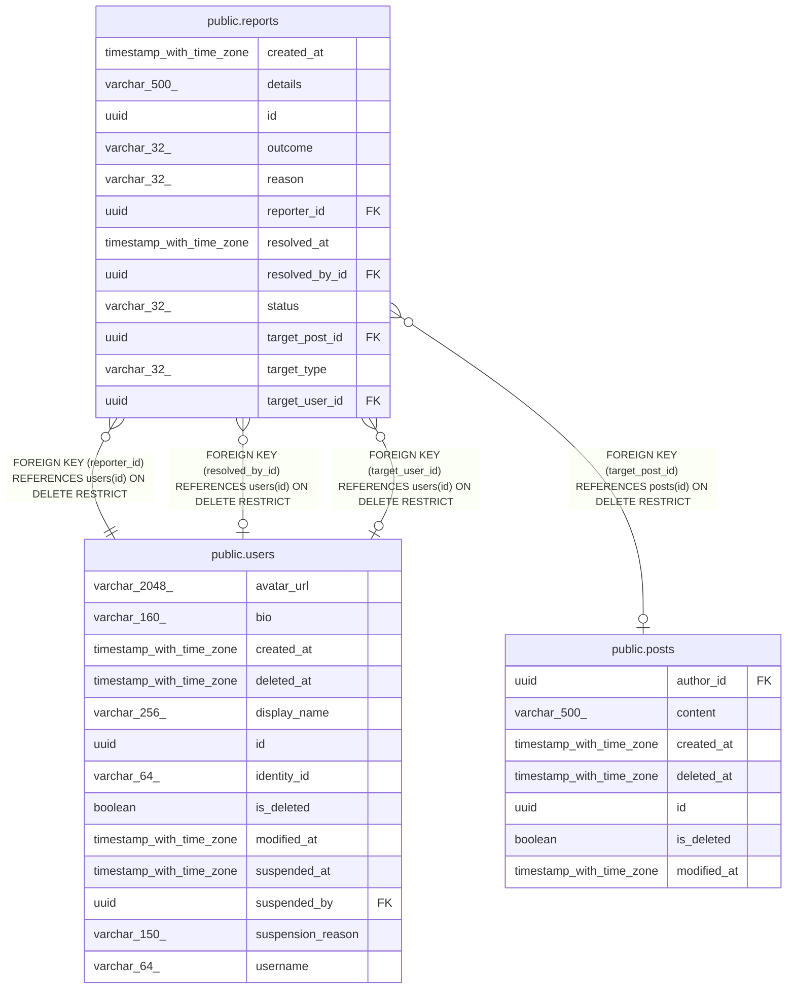

# public.reports

## Description

Reports from users about a post or another user, waiting for or finished with a moderator's decision.

## Columns

| Name           | Type                     | Default | Nullable | Children | Parents                         | Comment                                                            |
| -------------- | ------------------------ | ------- | -------- | -------- | ------------------------------- | ------------------------------------------------------------------ |
| created_at     | timestamp with time zone |         | false    |          |                                 | When the report was made.                                          |
| details        | varchar(500)             |         | true     |          |                                 | Explanation written by the reporter; null when none was given.     |
| id             | uuid                     |         | false    |          |                                 | Primary key, generated by the API.                                 |
| outcome        | varchar(32)              |         | true     |          |                                 | Decision on the report, Dismissed or ActionTaken; null while open. |
| reason         | varchar(32)              |         | false    |          |                                 | Why it was reported, such as Spam or Harassment.                   |
| reporter_id    | uuid                     |         | false    |          | [public.users](public.users.md) | User who made the report.                                          |
| resolved_at    | timestamp with time zone |         | true     |          |                                 | When the decision was made; null while open.                       |
| resolved_by_id | uuid                     |         | true     |          | [public.users](public.users.md) | Moderator who decided; null while open.                            |
| status         | varchar(32)              |         | false    |          |                                 | Open while waiting for a decision, Resolved afterwards.            |
| target_post_id | uuid                     |         | true     |          | [public.posts](public.posts.md) | Reported post; null unless the target is a post.                   |
| target_type    | varchar(32)              |         | false    |          |                                 | What was reported, Post or User.                                   |
| target_user_id | uuid                     |         | true     |          | [public.users](public.users.md) | Reported user; null unless the target is a user.                   |

## Constraints

| Name                            | Type        | Definition                                                                                                                                                                                                             |
| ------------------------------- | ----------- | ---------------------------------------------------------------------------------------------------------------------------------------------------------------------------------------------------------------------- |
| ck_reports_target               | CHECK       | CHECK ((((target_post_id IS NOT NULL) AND (target_user_id IS NULL) AND ((target_type)::text = 'Post'::text)) OR ((target_post_id IS NULL) AND (target_user_id IS NOT NULL) AND ((target_type)::text = 'User'::text)))) |
| fk_reports_posts_target_post_id | FOREIGN KEY | FOREIGN KEY (target_post_id) REFERENCES posts(id) ON DELETE RESTRICT                                                                                                                                                   |
| fk_reports_user_reporter_id     | FOREIGN KEY | FOREIGN KEY (reporter_id) REFERENCES users(id) ON DELETE RESTRICT                                                                                                                                                      |
| fk_reports_user_resolved_by_id  | FOREIGN KEY | FOREIGN KEY (resolved_by_id) REFERENCES users(id) ON DELETE RESTRICT                                                                                                                                                   |
| fk_reports_user_target_user_id  | FOREIGN KEY | FOREIGN KEY (target_user_id) REFERENCES users(id) ON DELETE RESTRICT                                                                                                                                                   |
| pk_reports                      | PRIMARY KEY | PRIMARY KEY (id)                                                                                                                                                                                                       |
| reports_created_at_not_null     | n           | NOT NULL created_at                                                                                                                                                                                                    |
| reports_id_not_null             | n           | NOT NULL id                                                                                                                                                                                                            |
| reports_reason_not_null         | n           | NOT NULL reason                                                                                                                                                                                                        |
| reports_reporter_id_not_null    | n           | NOT NULL reporter_id                                                                                                                                                                                                   |
| reports_status_not_null         | n           | NOT NULL status                                                                                                                                                                                                        |
| reports_target_type_not_null    | n           | NOT NULL target_type                                                                                                                                                                                                   |

## Indexes

| Name                                       | Definition                                                                                                                                                                                          |
| ------------------------------------------ | --------------------------------------------------------------------------------------------------------------------------------------------------------------------------------------------------- |
| ix_reports_created_at_id_open              | CREATE INDEX ix_reports_created_at_id_open ON public.reports USING btree (created_at, id) WHERE ((status)::text = 'Open'::text)                                                                     |
| ix_reports_reporter_id_target_post_id_open | CREATE UNIQUE INDEX ix_reports_reporter_id_target_post_id_open ON public.reports USING btree (reporter_id, target_post_id) WHERE (((status)::text = 'Open'::text) AND (target_post_id IS NOT NULL)) |
| ix_reports_reporter_id_target_user_id_open | CREATE UNIQUE INDEX ix_reports_reporter_id_target_user_id_open ON public.reports USING btree (reporter_id, target_user_id) WHERE (((status)::text = 'Open'::text) AND (target_user_id IS NOT NULL)) |
| ix_reports_resolved_by_id                  | CREATE INDEX ix_reports_resolved_by_id ON public.reports USING btree (resolved_by_id)                                                                                                               |
| ix_reports_target_post_id                  | CREATE INDEX ix_reports_target_post_id ON public.reports USING btree (target_post_id)                                                                                                               |
| ix_reports_target_user_id                  | CREATE INDEX ix_reports_target_user_id ON public.reports USING btree (target_user_id)                                                                                                               |
| pk_reports                                 | CREATE UNIQUE INDEX pk_reports ON public.reports USING btree (id)                                                                                                                                   |

## Relations

---

> Generated by [tbls](https://github.com/k1LoW/tbls)
