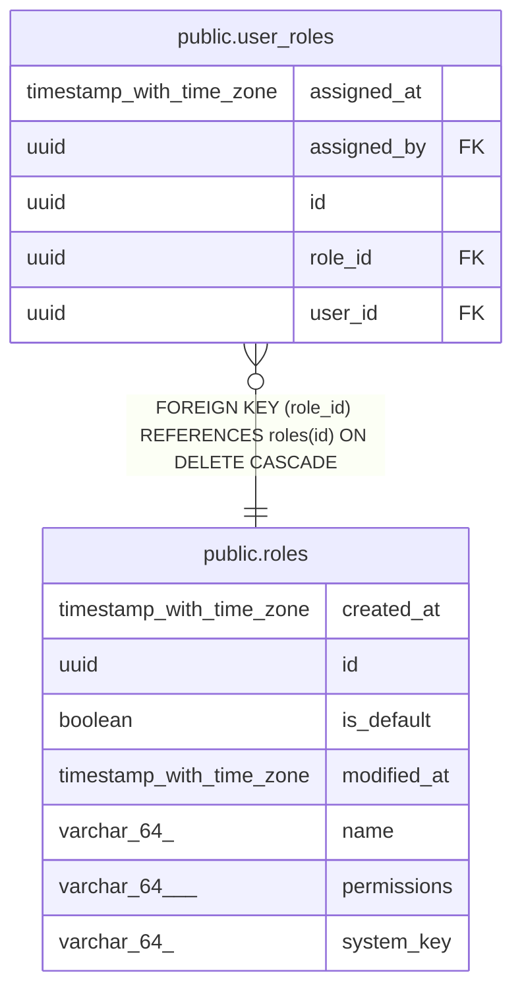

# public.roles

## Description

Named sets of permissions that users can hold. Roles and their permissions can change while the system runs.

## Columns

| Name        | Type                     | Default | Nullable | Children                                  | Parents | Comment                                                                                                |
| ----------- | ------------------------ | ------- | -------- | ----------------------------------------- | ------- | ------------------------------------------------------------------------------------------------------ |
| created_at  | timestamp with time zone |         | false    |                                           |         | When the row was created.                                                                              |
| id          | uuid                     |         | false    | [public.user_roles](public.user_roles.md) |         | Primary key, generated by the API.                                                                     |
| is_default  | boolean                  |         | false    |                                           |         | True for the role every signed-in user has without being assigned it. At most one role is the default. |
| modified_at | timestamp with time zone |         | false    |                                           |         | When the row was last changed.                                                                         |
| name        | varchar(64)              |         | false    |                                           |         | Name shown to people; can be changed.                                                                  |
| permissions | varchar(64)[]            |         | false    |                                           |         | Codes of the permissions the role grants, from the permission catalog in code.                         |
| system_key  | varchar(64)              |         | true     |                                           |         | Fixed key of a role the system creates itself, such as admin; null for roles created by people.        |

## Constraints

| Name                       | Type        | Definition           |
| -------------------------- | ----------- | -------------------- |
| pk_roles                   | PRIMARY KEY | PRIMARY KEY (id)     |
| roles_created_at_not_null  | n           | NOT NULL created_at  |
| roles_id_not_null          | n           | NOT NULL id          |
| roles_is_default_not_null  | n           | NOT NULL is_default  |
| roles_modified_at_not_null | n           | NOT NULL modified_at |
| roles_name_not_null        | n           | NOT NULL name        |
| roles_permissions_not_null | n           | NOT NULL permissions |

## Indexes

| Name                | Definition                                                                                        |
| ------------------- | ------------------------------------------------------------------------------------------------- |
| ix_roles_is_default | CREATE UNIQUE INDEX ix_roles_is_default ON public.roles USING btree (is_default) WHERE is_default |
| ix_roles_name       | CREATE UNIQUE INDEX ix_roles_name ON public.roles USING btree (lower((name)::text))               |
| ix_roles_system_key | CREATE UNIQUE INDEX ix_roles_system_key ON public.roles USING btree (system_key)                  |
| pk_roles            | CREATE UNIQUE INDEX pk_roles ON public.roles USING btree (id)                                     |

## Relations

---

> Generated by [tbls](https://github.com/k1LoW/tbls)
