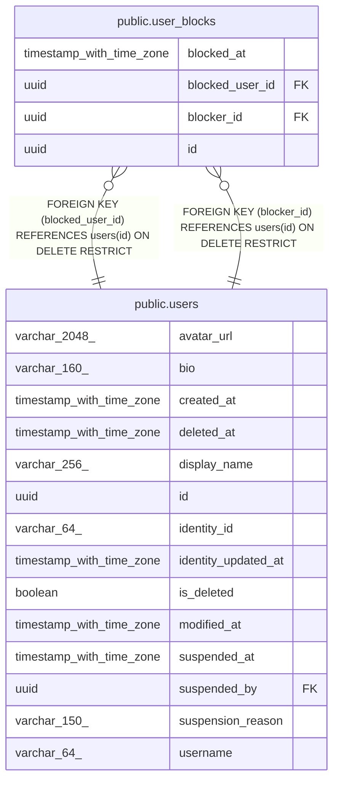

# public.user_blocks

## Description

Active blocks between users.

## Columns

| Name            | Type                     | Default | Nullable | Children | Parents                         | Comment                               |
| --------------- | ------------------------ | ------- | -------- | -------- | ------------------------------- | ------------------------------------- |
| blocked_at      | timestamp with time zone |         | false    |          |                                 | When the user blocked the other user. |
| blocked_user_id | uuid                     |         | false    |          | [public.users](public.users.md) | User who was blocked.                 |
| blocker_id      | uuid                     |         | false    |          | [public.users](public.users.md) | User who blocked the other user.      |
| id              | uuid                     |         | false    |          |                                 | Primary key, generated by the API.    |

## Constraints

| Name                                 | Type        | Definition                                                            |
| ------------------------------------ | ----------- | --------------------------------------------------------------------- |
| fk_user_blocks_user_blocked_user_id  | FOREIGN KEY | FOREIGN KEY (blocked_user_id) REFERENCES users(id) ON DELETE RESTRICT |
| fk_user_blocks_user_blocker_id       | FOREIGN KEY | FOREIGN KEY (blocker_id) REFERENCES users(id) ON DELETE RESTRICT      |
| pk_user_blocks                       | PRIMARY KEY | PRIMARY KEY (id)                                                      |
| user_blocks_blocked_at_not_null      | n           | NOT NULL blocked_at                                                   |
| user_blocks_blocked_user_id_not_null | n           | NOT NULL blocked_user_id                                              |
| user_blocks_blocker_id_not_null      | n           | NOT NULL blocker_id                                                   |
| user_blocks_id_not_null              | n           | NOT NULL id                                                           |

## Indexes

| Name                                      | Definition                                                                                                                    |
| ----------------------------------------- | ----------------------------------------------------------------------------------------------------------------------------- |
| ix_user_blocks_blocked_user_id            | CREATE INDEX ix_user_blocks_blocked_user_id ON public.user_blocks USING btree (blocked_user_id)                               |
| ix_user_blocks_blocker_id_blocked_user_id | CREATE UNIQUE INDEX ix_user_blocks_blocker_id_blocked_user_id ON public.user_blocks USING btree (blocker_id, blocked_user_id) |
| pk_user_blocks                            | CREATE UNIQUE INDEX pk_user_blocks ON public.user_blocks USING btree (id)                                                     |

## Relations

---

> Generated by [tbls](https://github.com/k1LoW/tbls)
