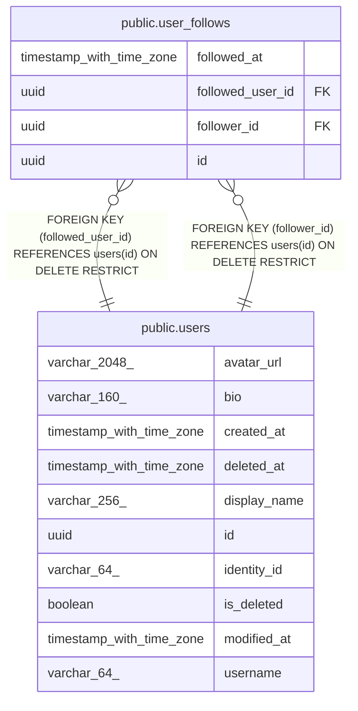

# public.user_follows

## Description

Active follow relationships between users.

## Columns

| Name             | Type                     | Default | Nullable | Children | Parents                         | Comment                                         |
| ---------------- | ------------------------ | ------- | -------- | -------- | ------------------------------- | ----------------------------------------------- |
| followed_at      | timestamp with time zone |         | false    |          |                                 | When the user started following the other user. |
| followed_user_id | uuid                     |         | false    |          | [public.users](public.users.md) | User being followed.                            |
| follower_id      | uuid                     |         | false    |          | [public.users](public.users.md) | User who initiated the follow.                  |
| id               | uuid                     |         | false    |          |                                 | Primary key, generated by the API.              |

## Constraints

| Name                                   | Type        | Definition                                                             |
| -------------------------------------- | ----------- | ---------------------------------------------------------------------- |
| fk_user_follows_users_followed_user_id | FOREIGN KEY | FOREIGN KEY (followed_user_id) REFERENCES users(id) ON DELETE RESTRICT |
| fk_user_follows_users_follower_id      | FOREIGN KEY | FOREIGN KEY (follower_id) REFERENCES users(id) ON DELETE RESTRICT      |
| pk_user_follows                        | PRIMARY KEY | PRIMARY KEY (id)                                                       |
| user_follows_followed_at_not_null      | n           | NOT NULL followed_at                                                   |
| user_follows_followed_user_id_not_null | n           | NOT NULL followed_user_id                                              |
| user_follows_follower_id_not_null      | n           | NOT NULL follower_id                                                   |
| user_follows_id_not_null               | n           | NOT NULL id                                                            |

## Indexes

| Name                                         | Definition                                                                                                                          |
| -------------------------------------------- | ----------------------------------------------------------------------------------------------------------------------------------- |
| ix_user_follows_followed_user_id             | CREATE INDEX ix_user_follows_followed_user_id ON public.user_follows USING btree (followed_user_id)                                 |
| ix_user_follows_follower_id_followed_user_id | CREATE UNIQUE INDEX ix_user_follows_follower_id_followed_user_id ON public.user_follows USING btree (follower_id, followed_user_id) |
| pk_user_follows                              | CREATE UNIQUE INDEX pk_user_follows ON public.user_follows USING btree (id)                                                         |

## Relations

---

> Generated by [tbls](https://github.com/k1LoW/tbls)
