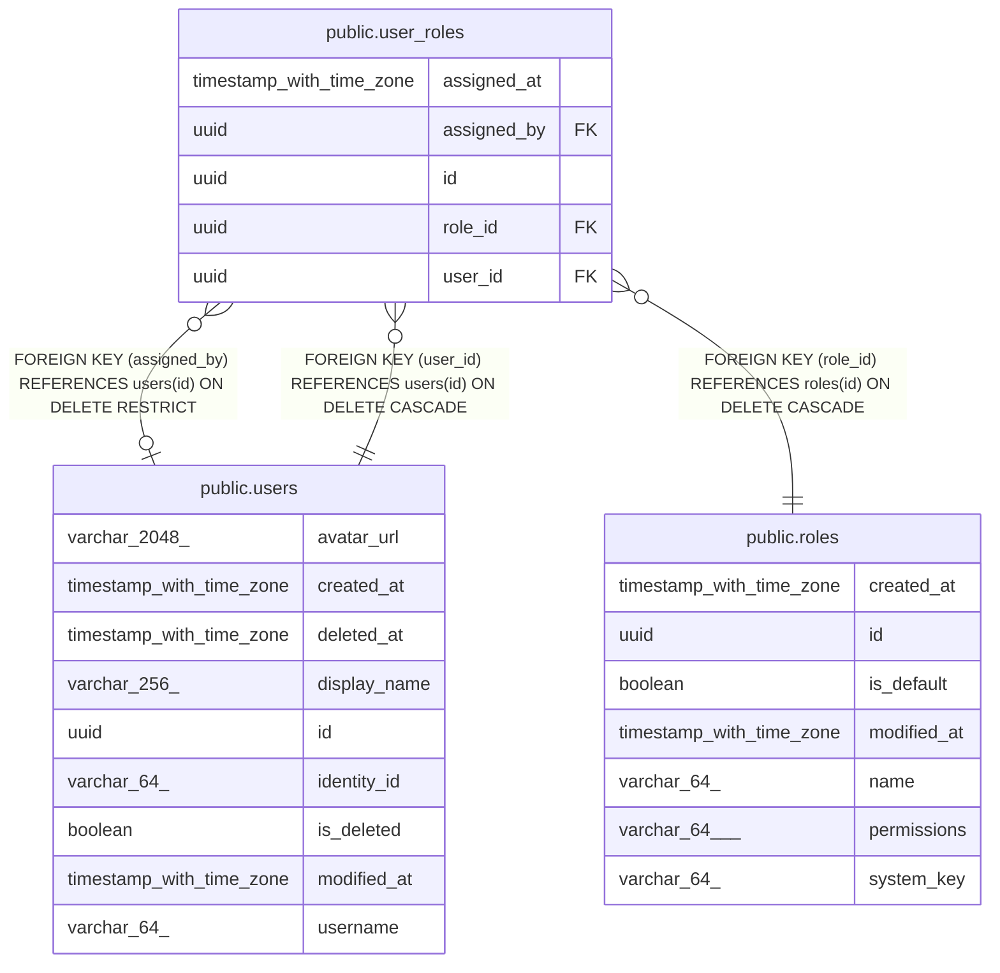

# public.user_roles

## Description

Roles assigned to users, besides the default role that every signed-in user has.

## Columns

| Name        | Type                     | Default | Nullable | Children | Parents                         | Comment                                                                                        |
| ----------- | ------------------------ | ------- | -------- | -------- | ------------------------------- | ---------------------------------------------------------------------------------------------- |
| assigned_at | timestamp with time zone |         | false    |          |                                 | When the role was assigned.                                                                    |
| assigned_by | uuid                     |         | true     |          | [public.users](public.users.md) | User who assigned the role; null when the system assigned it, such as the first administrator. |
| id          | uuid                     |         | false    |          |                                 | Primary key, generated by the API.                                                             |
| role_id     | uuid                     |         | false    |          | [public.roles](public.roles.md) | Role the user holds.                                                                           |
| user_id     | uuid                     |         | false    |          | [public.users](public.users.md) | User who holds the role.                                                                       |

## Constraints

| Name                            | Type        | Definition                                                        |
| ------------------------------- | ----------- | ----------------------------------------------------------------- |
| fk_user_roles_roles_role_id     | FOREIGN KEY | FOREIGN KEY (role_id) REFERENCES roles(id) ON DELETE CASCADE      |
| fk_user_roles_users_assigned_by | FOREIGN KEY | FOREIGN KEY (assigned_by) REFERENCES users(id) ON DELETE RESTRICT |
| fk_user_roles_users_user_id     | FOREIGN KEY | FOREIGN KEY (user_id) REFERENCES users(id) ON DELETE CASCADE      |
| pk_user_roles                   | PRIMARY KEY | PRIMARY KEY (id)                                                  |
| user_roles_assigned_at_not_null | n           | NOT NULL assigned_at                                              |
| user_roles_id_not_null          | n           | NOT NULL id                                                       |
| user_roles_role_id_not_null     | n           | NOT NULL role_id                                                  |
| user_roles_user_id_not_null     | n           | NOT NULL user_id                                                  |

## Indexes

| Name                          | Definition                                                                                            |
| ----------------------------- | ----------------------------------------------------------------------------------------------------- |
| ix_user_roles_assigned_by     | CREATE INDEX ix_user_roles_assigned_by ON public.user_roles USING btree (assigned_by)                 |
| ix_user_roles_role_id         | CREATE INDEX ix_user_roles_role_id ON public.user_roles USING btree (role_id)                         |
| ix_user_roles_user_id_role_id | CREATE UNIQUE INDEX ix_user_roles_user_id_role_id ON public.user_roles USING btree (user_id, role_id) |
| pk_user_roles                 | CREATE UNIQUE INDEX pk_user_roles ON public.user_roles USING btree (id)                               |

## Relations

---

> Generated by [tbls](https://github.com/k1LoW/tbls)
