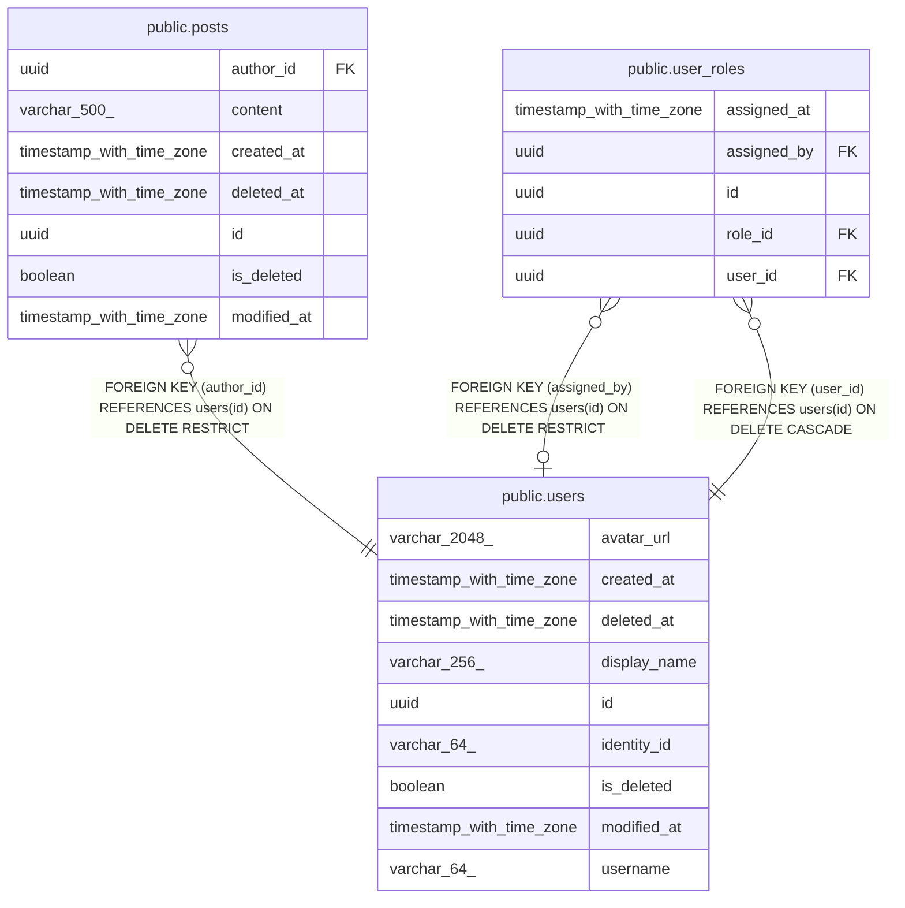

# public.users

## Description

People who use choco-api. Sign-in lives in Clerk; each row is the local copy of one Clerk user.

## Columns

| Name         | Type                     | Default | Nullable | Children                                                                  | Parents | Comment                                                                             |
| ------------ | ------------------------ | ------- | -------- | ------------------------------------------------------------------------- | ------- | ----------------------------------------------------------------------------------- |
| avatar_url   | varchar(2048)            |         | true     |                                                                           |         | Profile image URL from Clerk; null when the user has none.                          |
| created_at   | timestamp with time zone |         | false    |                                                                           |         | When the row was created.                                                           |
| deleted_at   | timestamp with time zone |         | true     |                                                                           |         | When the row was soft-deleted; null while it is not.                                |
| display_name | varchar(256)             |         | false    |                                                                           |         | Name shown to other users. Defaults to the username when Clerk has no name.         |
| id           | uuid                     |         | false    | [public.posts](public.posts.md) [public.user_roles](public.user_roles.md) |         | Primary key, generated by the API.                                                  |
| identity_id  | varchar(64)              |         | false    |                                                                           |         | Clerk user id (the sub claim) that links the row to its Clerk account.              |
| is_deleted   | boolean                  |         | false    |                                                                           |         | True when the row is soft-deleted. Queries skip such rows unless they ask for them. |
| modified_at  | timestamp with time zone |         | false    |                                                                           |         | When the row was last changed.                                                      |
| username     | varchar(64)              |         | false    |                                                                           |         | Handle copied from Clerk. Unique among users that are not deleted.                  |

## Constraints

| Name                        | Type        | Definition            |
| --------------------------- | ----------- | --------------------- |
| pk_users                    | PRIMARY KEY | PRIMARY KEY (id)      |
| users_created_at_not_null   | n           | NOT NULL created_at   |
| users_display_name_not_null | n           | NOT NULL display_name |
| users_id_not_null           | n           | NOT NULL id           |
| users_identity_id_not_null  | n           | NOT NULL identity_id  |
| users_is_deleted_not_null   | n           | NOT NULL is_deleted   |
| users_modified_at_not_null  | n           | NOT NULL modified_at  |
| users_username_not_null     | n           | NOT NULL username     |

## Indexes

| Name                 | Definition                                                                                              |
| -------------------- | ------------------------------------------------------------------------------------------------------- |
| ix_users_identity_id | CREATE UNIQUE INDEX ix_users_identity_id ON public.users USING btree (identity_id)                      |
| ix_users_username    | CREATE UNIQUE INDEX ix_users_username ON public.users USING btree (username) WHERE (is_deleted = false) |
| pk_users             | CREATE UNIQUE INDEX pk_users ON public.users USING btree (id)                                           |

## Relations

---

> Generated by [tbls](https://github.com/k1LoW/tbls)
